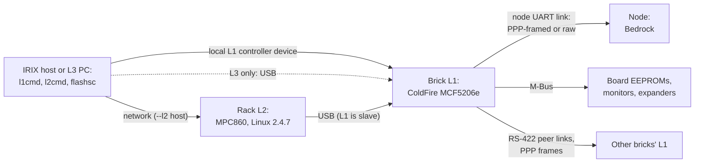
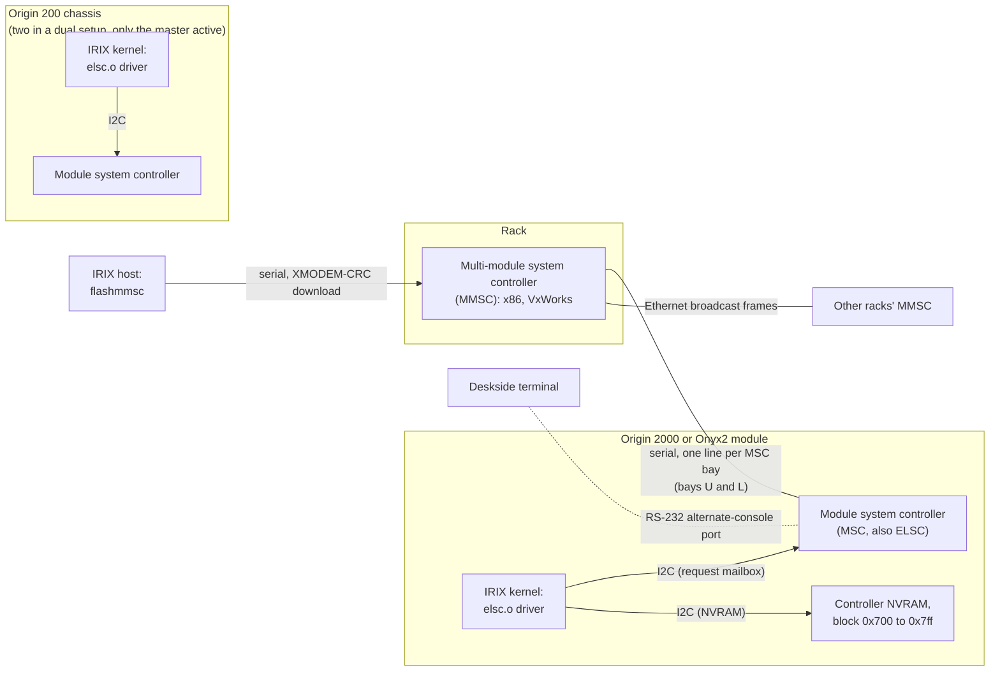

# sysco

Notes on SGI's system controllers: the L1 in every Origin 300, 3000 and 350 brick, the L2 that runs a rack, and
the older MSC and MMSC from the Origin 2000 and Onyx2. They look after power, the board monitors and the console.
The name is the directory IRIX ships their firmware in, `usr/cpu/firmware/sysco`.

It's all read out of the firmware images and host tools that ship with IRIX, plus the public IRIX source, SGI
manuals and the Linux and BSD drivers. Every fact notes where it came from and whether it's established,
inferred or still unknown.

What comes out is a description of each controller (its chips, addresses, protocols, how it boots and the
requests it answers) and headers in C, Rust, Python, JSON and XML.

## Controllers

- **L1, Origin 300:** a ColdFire MCF5206e running firmware 1.44.0, and the one read most closely. Boot, the
  M-Bus and board records, the USB device side, the RS-422 router and the node link.
- **L1, other bricks:** the C-, I- and R-brick firmware, compared routine by routine against the Origin 300 one.
- **L1, ARM Linux images:** kernel and file system found and the programs listed. Not much of the userland is
  read yet.
- **L2:** a PowerPC MPC860 running Linux 2.4.7. Boot loader, memory map, kernel interface and how it talks to
  the L1s. The file system isn't fully walked.
- **MMSC:** x86 running VxWorks. Segment map, symbols, flash and NVRAM, and the download protocol.
- **Older machines:** no firmware held for the Everest-era controllers, just the IRIX drivers and daemons that
  talk to them.

The firmware pages are under [software/firmware/](software/firmware/), the boards under
[devices/](devices/README.md) and [platforms/](platforms/README.md).

## How they connect

Origin 300 and 3000:

<!-- Question: which controller talks to which, over what link? Evidence: the sources linked above. The L1 is a USB slave to upstream controllers, the L2 runs the USB host side (OHCI, sgil1 driver), the IRIX tools name an L2 by host/interface or a local L1 controller device, an L3 PC reaches an L2 over Ethernet or an L1 over USB. Only links those notes state are drawn; the L1 to node serial selectors are not tied to connector nets by any image. -->


Origin 2000, Onyx2 and Origin 200. No MSC firmware is held, so the MSC side comes from the IRIX driver and the
MMSC's client for it.

<!-- Question: which older-generation controller talks to which, over what link? Evidence: software/firmware/controllers.md (families MSC and ELSC, MMSC: Ethernet between MMSCs, one serial cable to each module's MSC bays; Origin 200 has two MSCs in a dual-chassis setup with only the master active), formats/elsc_host/README.md (kernel driver elsc.o reaches the MSC over I2C: request mailbox at slave 8, NVRAM at 0x50, established; same driver object serves Origin 200, 2000 and Onyx2), platforms/ip27/module-management.md (one MSC per four-node module on one shared management I2C bus with NVRAM; one RS-232 alternate-console port, a deskside terminal or, in a rack module, the multimodule controller; all hint grade from the diagnostic roadmap figure), software/firmware/mmsc/msc-client.md (MMSC firmware talks to up to two MSCs over two serial lines, bays U and L, read from the image), rack-election.md (MMSCs on one Ethernet segment), flash-nvram-download.md (flashmmsc flashes the MMSC over the serial line). Dotted edge: the deskside terminal on the alternate-console port, hint grade only. Not drawn: any link between the two Origin 200 MSCs, any MSC CPU or firmware path (none is stated), mmscd's link to the MMSC (not read), the Hub-side I2C interface per node (hint, not tied to a connector). -->


## Using it

The headers and the crate live in [generated/](generated/). Don't edit them; they're built from the
TOML under `devices/` and `formats/`.

To run the checks yourself:

```sh
git clone https://github.com/jamesbraid/sysco && cd sysco
tools/setup-clone.sh --root /path/to/your/irix/files
retools/tools/re-run retools/tools/defs/ci-check
```

You'll need Podman, git, python3 and your own IRIX files. [references/irix-files.md](references/irix-files.md) lists
which ones.

## How far along

The Origin 300 L1's requests, registers and protocols are done. The firmware functions are barely started. The open questions are in [questions/](questions/README.md).
If you spot a mistake or have a manual we don't, [open an issue](https://github.com/jamesbraid/sysco/issues).

<!-- coverage:begin -->
<!-- Generated from the firmware block of COVERAGE.md; do not edit. Regenerate: retools/tools/re-run python3 retools/tools/sysco/sysco_tables.py -->
| Table | Rows | Understood | Located | % understood | % located or better |
|---|---:|---:|---:|---:|---:|
| [images](generated/inventory/images.tsv) | 219 | 28 | 44 | 12.8 | 32.9 |
| [packages](generated/inventory/packages.tsv) | 70 | 4 | 66 | 5.7 | 100.0 |
| [firmware-functions](generated/inventory/firmware-functions.tsv) | 191808 | 672 | 111850 | 0.4 | 58.7 |
| [request-codes](generated/inventory/request-codes.tsv) | 201 | 198 | 3 | 98.5 | 100.0 |
| [io-registers](generated/inventory/io-registers.tsv) | 44 | 44 | 0 | 100.0 | 100.0 |
| [protocols](generated/inventory/protocols.tsv) | 39 | 39 | 0 | 100.0 | 100.0 |
<!-- coverage:end -->

## License

[BSD 3-Clause](LICENSE). The `retools/` scripts started life as gr4's and keep its notice. No SGI binaries in
here; bring your own.

## Credits

James Braid, plus a lot of Claude and Codex reading ColdFire and PowerPC disassembly so I didn't have to.

Thanks to -

* Dominik Behr ([@techomancer](https://github.com/techomancer)) for [gr2](https://github.com/techomancer/gr2)
  and [gr4](https://github.com/techomancer/gr4), where the layout and working style come from
* SGI's technical writers, whose L1 and L2 guides and owner's guides describe more of these controllers than
  you'd expect
* Freescale and Philips, for the ColdFire and I2C controller manuals
* Everyone keeping SGI manuals, `hinv` dumps and IRIX media online
